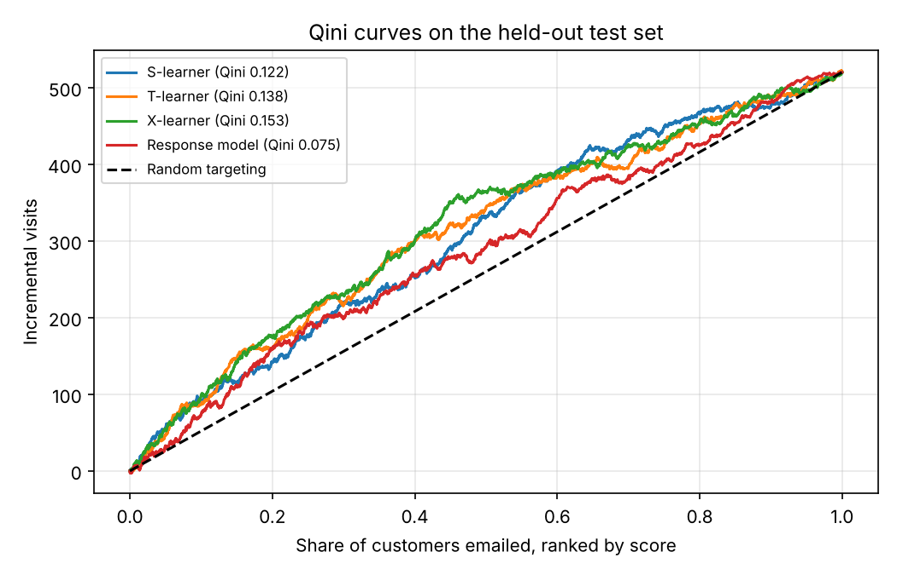
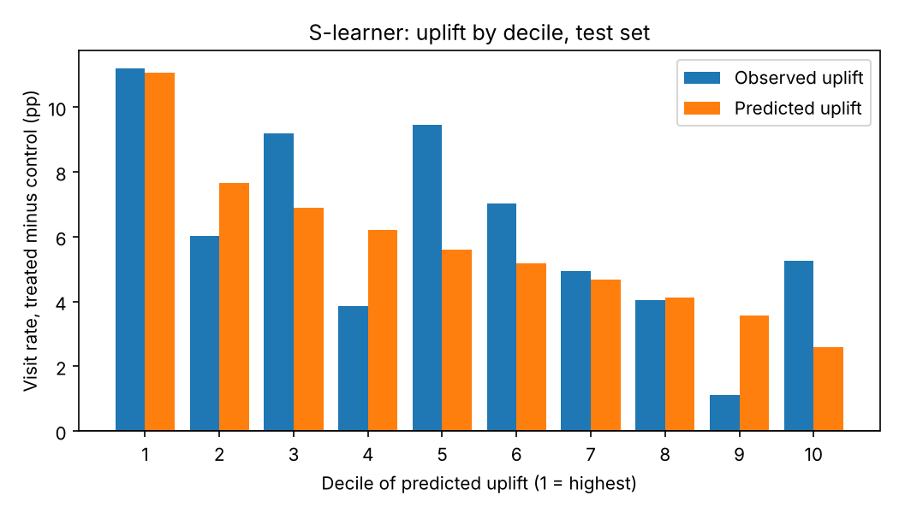
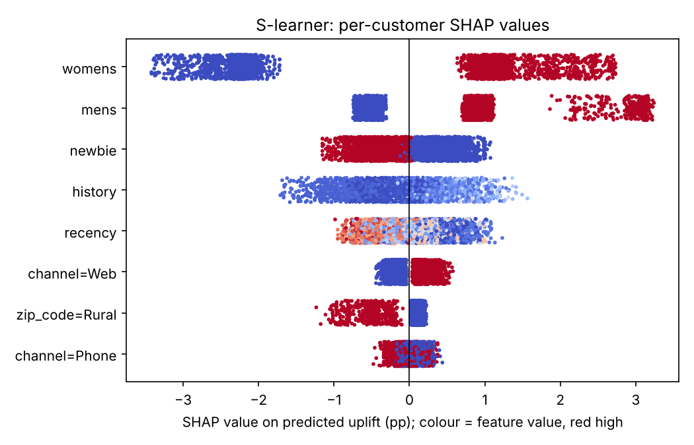

# LiftLens

**Uplift modelling for email targeting: who visits *because of* an email, not who would visit anyway.**

A response model ranks customers by how likely they are to act after an email. Many of them would have
acted without it, so that budget is wasted. Uplift modelling ranks customers by the **change** an email
causes: P(visit | emailed) − P(visit | not emailed). LiftLens trains three uplift meta-learners on a
real randomised experiment, picks one by cross-validation, measures it on an untouched test set with
bootstrap confidence intervals, and explains it with SHAP.

**Walkthrough:** [`demo.ipynb`](demo.ipynb) trains the chosen model and shows every plot in about a minute.

## Results (held-out test set, 12,800 customers)

| Model | CV Qini (choice) | Test Qini | 95% CI | Uplift in top 30% | Extra visits vs random 30% |
|---|---|---|---|---|---|
| **S-learner (chosen by CV)** | **0.092** | **0.122** | 0.044 – 0.200 | **8.7 pp** | **+42%** (CI +11% to +74%) |
| T-learner | 0.064 | 0.138 | 0.060 – 0.224 | 8.6 pp | +41% (CI +12% to +76%) |
| X-learner | 0.081 | 0.153 | 0.075 – 0.231 | 9.1 pp | +49% (CI +20% to +85%) |
| Response model (baseline) | 0.058 | 0.075 | −0.004 – 0.153 | 7.9 pp | +30% (CI −2% to +65%) |

* **Budget question.** Emailing 30% of customers (3,840) at random brings about 234 extra visits on the test
  set. Targeting the same number by the chosen S-learner brings **42% more**. Across 1,000 paired bootstrap
  resamples the gain stays above zero 99.5% of the time.
* **Top decile.** The 10% of customers with the highest predicted uplift showed an observed uplift of
  **11.2 points** (95% CI 7.0 to 15.9), against **6.1 points** for the whole test set.
* **All three uplift learners beat the response model**, which is the usual way campaigns are targeted.
  The S-learner's margin over it (+0.048 Qini) has a 95% interval of −0.012 to +0.112, so on 12,800
  customers that particular gap is suggestive rather than conclusive.
* **Model choice is honest.** The S-learner was selected by 5-fold cross-validated Qini before the test set
  was scored. The X-learner happened to score highest on test, but the cross-validation spread (±0.04 to
  0.05) is larger than the gaps between learners, so the three are statistically close.





### What drives the uplift (TreeSHAP)

An XGBoost surrogate reproduces the S-learner's predicted uplift with **R² = 0.99** on test data, so its
exact TreeSHAP values describe the real model faithfully.

| Feature | Mean \|SHAP\| (pp of uplift) | Effect |
|---|---|---|
| Bought women's merchandise last year | 1.76 | raises uplift |
| Bought men's merchandise last year | 0.93 | raises uplift |
| New customer in the last 12 months | 0.45 | lowers uplift |
| Spend in the last year | 0.45 | higher spend, higher uplift |
| Months since last purchase | 0.37 | recent buyers respond more |



## Data

**Hillstrom MineThatData E-Mail Analytics Challenge (2008).** 64,000 customers who bought in the last
12 months were randomly split three ways: a men's merchandise email, a women's merchandise email, or no
email. Outcomes were tracked for two weeks.

* Treatment: any email (two thirds of customers) against no email.
* Primary outcome: website visit (visit rate 16.7% emailed vs 10.6% not, average effect +6.1 points).
* Features: recency, purchase history, men's and women's purchases, new customer flag, zip code type,
  purchase channel. Outcome columns (visit, conversion, spend) never enter the features.
* Randomisation check: the largest standardised mean difference of any feature between emailed and
  non-emailed customers is **0.009**, so the groups are balanced and observed differences are causal.

## Method

1. **Split.** 64% train, 16% validation, 20% test, stratified on treatment × outcome (seed 42).
2. **Learners** (all XGBoost)
   * **S-learner**: one classifier on features plus the treatment flag; uplift = f(x, 1) − f(x, 0).
   * **T-learner**: separate classifiers for emailed and non-emailed customers; uplift = μ₁(x) − μ₀(x).
   * **X-learner**: imputes each customer's effect from the other group's model, regresses it, and
     blends the two by the propensity score, which is the known 2/3 treatment share in this experiment.
   * **Response model**: P(visit | emailed), the baseline most campaigns use.
3. **Model selection.** Grid over tree depth and minimum child weight, scored by **5-fold cross-validated
   Qini** on train + validation. Early stopping on log loss inside every fit.
4. **Evaluation**
   * **Qini coefficient**: area between the model's Qini curve and random targeting, divided by the same
     area for a perfect ordering. 0 = random, 1 = perfect.
   * **Uplift at 30%**: treated minus control visit rate among the top 30% by score.
   * **Gain vs random**: incremental visits from targeting the top 30% against a random 30%.
   * **1,000 paired bootstrap resamples** of the test set for every confidence interval.
   * **5 training seeds** per learner to separate model randomness from data noise.
5. **Explanation**: XGBoost surrogate on predicted uplift, exact TreeSHAP via
   `pred_contribs`, fidelity checked by R² on test data.

## Reproduce

```bash
pip install -r requirements.txt
python liftlens.py     # downloads the data, checks its SHA-256, writes results/ in about 2 minutes on a 2-core CPU
pytest -q              # checks the uplift metrics on synthetic data with a known effect
jupyter notebook demo.ipynb   # the walkthrough
```

`liftlens.py` holds the whole pipeline: data, learners, metrics, bootstrap, SHAP and figures. Every number
above is in `results/results.json`.

## Limitations

* Visits are the primary outcome because purchases are rare (under 1%). On conversion, the X-learner
  reaches a 0.25 Qini, but conversion counts on the test set are small, so those numbers are noisy.
* Uplift is estimated for the average effect of *any* email. Choosing *which* email (men's or women's)
  per customer is a natural extension.
* The data is from one retailer in 2008; effect sizes will differ for other businesses.
